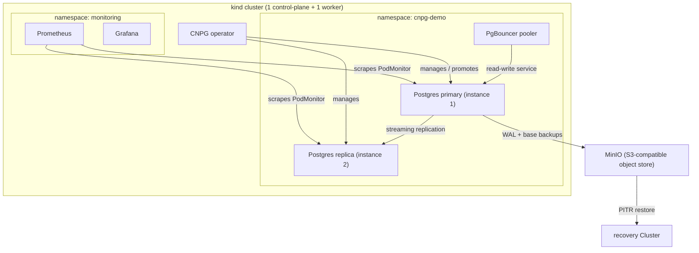

# cnpg-on-kind

> Production-shaped PostgreSQL on Kubernetes with HA, automated backup/restore to S3-compatible storage, a scripted failover demo, and Prometheus/Grafana observability — on a laptop via kind.


A self-contained, runnable demo of how I'd run PostgreSQL as a **system of record** on Kubernetes using the [CloudNativePG](https://cloudnative-pg.io) (CNPG) operator. Everything here runs on a single 8 GB laptop via [kind](https://kind.sigs.k8s.io/) — no cloud account required.

---

## Why I built this

Payments and ledger systems treat the database as the source of truth: losing or corrupting it is unrecoverable, and downtime is revenue lost. Running that on Kubernetes is a different discipline from running a stateless web tier — you care about failover behaviour, replication lag, backup integrity, and *proving* you can restore.

This repo is my hands-on reference for that discipline. It is deliberately small enough to run on a laptop but shaped like the real thing: an HA cluster managed by an operator, continuous backups to object storage, point-in-time recovery, a connection pooler, and alerting on the metrics that actually matter (replication lag, connection saturation). The failover demo is scripted so the recovery behaviour is *observable*, not just asserted.

---

## Architecture



| Component | Role |
|-----------|------|
| CNPG operator | Reconciles the `Cluster` CR, handles failover/switchover, manages backups |
| `Cluster` (instances: 2) | 1 primary + 1 synchronous-capable replica with streaming replication |
| Pooler (PgBouncer) | Connection pooling in front of the read-write endpoint |
| MinIO | S3-compatible object store for WAL archiving and base backups |
| kube-prometheus-stack | Prometheus scrapes the CNPG PodMonitor; Grafana visualises |

---

## Prerequisites & resource budget

This is tuned to fit an **8 GB M1 MacBook Air**. Resource requests are deliberately small (see `postgres/cluster.yaml`). Expect the full stack (2 Postgres instances + MinIO + Prometheus + Grafana) to sit around 2.5–3.5 GB of container memory.

| Tool | Version (tested) | Install |
|------|------------------|---------|
| Docker / OrbStack | recent | OrbStack recommended on Apple Silicon |
| kind | v0.23+ | `brew install kind` |
| kubectl | v1.30+ | `brew install kubectl` |
| helm | v3.14+ | `brew install helm` |

> Tip on Apple Silicon: CNPG images are multi-arch (arm64 available), so no emulation is needed.

---

## Quickstart

```bash
# Bring up everything: kind cluster -> operator -> namespace -> Postgres -> MinIO -> backup config
make up

# Then, optionally, install observability (helm)
make observe
```

`make up` is idempotent enough to re-run. Individual phases are also targets — see `make help`.

```bash
make help        # list all targets
make cluster     # create the kind cluster only
make operator    # install the CNPG operator only
make db          # apply namespace + Cluster + pooler
make backup      # deploy MinIO + apply backup config + scheduled backup
make observe     # install kube-prometheus-stack + CNPG alerts
make failover    # run the scripted failover demo
make clean       # tear down everything
```

---

## What's inside

- **`postgres/cluster.yaml`** — a CNPG `Cluster` with `instances: 2` (1 primary + 1 replica), a pinned PostgreSQL image, `bootstrap.initdb` creating database `app` owned by role `app`, a `standard` storage class claim, tuned `postgresql.parameters` (slow-query logging, checkpoint logging, lock-wait logging), and `monitoring.enablePodMonitor: true`.
- **High availability** — the operator runs streaming replication between instances and promotes a replica automatically if the primary fails. The read-write Service (`<cluster>-rw`) always points at the current primary.
- **Pooler** — `postgres/pooler.yaml` runs PgBouncer in transaction-pooling mode in front of the RW endpoint, which is how you'd protect Postgres from connection storms in a payments app.

---

## Failover demo

This is the money shot: kill the primary and watch the operator promote the replica.

```bash
make failover
# or directly:
./scripts/failover-demo.sh
```

What the script does:

1. Reads the current primary from `kubectl get cluster cnpg-demo -o jsonpath='{.status.currentPrimary}'`.
2. Deletes that pod.
3. Watches `kubectl get cluster` until `.status.currentPrimary` changes and the cluster returns to healthy.

Expected output (abridged):

```
[info] current primary: cnpg-demo-1
[step] deleting primary pod cnpg-demo-1 ...
pod "cnpg-demo-1" deleted
[step] watching for promotion ...
NAME        AGE   INSTANCES   READY   STATUS                     PRIMARY
cnpg-demo   8m    2           1       Failing over              cnpg-demo-2
cnpg-demo   9m    2           2       Cluster in healthy state   cnpg-demo-2
[ok] new primary: cnpg-demo-2  (was cnpg-demo-1)
```

The old primary rejoins as a replica once its pod is rescheduled. Watch replication lag recover in Grafana or via the `cnpg_pg_replication_lag` metric.

---

## Backup & PITR restore

Backups go to MinIO (S3-compatible) via CNPG's Barman-based object-store integration.

```bash
# 1. MinIO + backup config + scheduled backup are deployed by `make backup`
make backup

# 2. Trigger an on-demand base backup
./scripts/backup-now.sh

# 3. Restore to a NEW cluster (point-in-time recovery)
./scripts/restore-pitr.sh
```

The restore creates a *separate* `Cluster` (`restore/recovery-cluster.yaml`) that bootstraps from the object store rather than mutating the live cluster — the safe way to test restores. Edit the `recoveryTarget` in that file to pick a specific point in time, or omit it to recover to the latest available WAL.

> See `backup/object-store.yaml` for which CNPG approach is used and which operator version it targets.

---

## Observability

Install the kube-prometheus-stack (Prometheus + Grafana) and the CNPG alerts:

```bash
make observe
```

Prometheus discovers the CNPG `PodMonitor` via the Helm release label (see `observability/README.md`). Two alerts ship in `observability/prometheusrule.yaml`, both using **real CNPG metric names**:

| Alert | Expression (summary) | Severity |
|-------|----------------------|----------|
| `CNPGReplicationLagHigh` | `cnpg_pg_replication_lag > 20` | critical |
| `CNPGConnectionSaturation` | high `cnpg_backends_total` relative to `max_connections` | warning |

Import the CNPG Grafana dashboard — see `observability/grafana-cnpg-dashboard.note.md`.

---

## Secrets handling

**There are no plaintext secrets in this repo, by design.** The application database credentials are created *imperatively* (`kubectl create secret`) or via a secret-management controller. See `secrets/README.md` for the Sealed Secrets / External Secrets options and the exact `kubectl create secret` command.

---

## Teardown

```bash
make clean      # deletes the kind cluster and all local state
```

This removes the kind cluster entirely, so MinIO data and all PVCs go with it.

---

## What I'd change for production

This is a laptop demo. For a real payments deployment I would change:

- **More replicas + anti-affinity.** `instances: 3` minimum, spread across availability zones with `topologySpreadConstraints` / pod anti-affinity so a node or AZ loss can't take down quorum. Consider synchronous replication (`minSyncReplicas`/`maxSyncReplicas`) for zero-RPO writes on critical paths.
- **Backups in a separate failure domain.** WAL + base backups to a different region/account from the primary, with object-lock / immutability to survive ransomware and operator error. Test restores on a schedule, not just once.
- **Explicit RPO/RTO targets.** Define them (e.g. RPO ≤ 5 min via continuous WAL archiving, RTO ≤ 15 min via tested PITR) and verify them with periodic game-days, not assumptions.
- **NetworkPolicy.** Default-deny, then allow only the pooler → Postgres and Prometheus → Postgres-metrics paths. Payments data shouldn't be reachable from arbitrary pods.
- **PodSecurity / hardening.** Enforce the `restricted` Pod Security Standard, run as non-root (CNPG already does), drop capabilities, read-only root filesystem where possible.
- **Resource sizing & QoS.** Real requests/limits sized from load tests, Guaranteed QoS for the database pods, and a PodDisruptionBudget so cluster maintenance can't evict quorum.
- **Secrets via a controller** (External Secrets backed by a cloud KMS / Vault), with rotation, rather than imperative `kubectl create secret`.

---

## License

MIT — see [LICENSE](./LICENSE).
